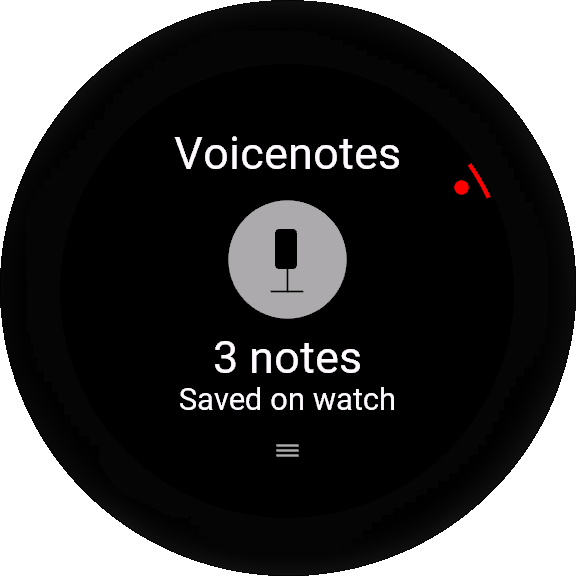

# Voicenotes for Garmin

**Press START. Say it. Keep moving.**

Record ideas and reminders right from your Garmin watch, even when you're offline.

<p align="center">
  
</p>

- **Record and replay on your wrist.** Your notes stay on the watch after syncing.
- **Take your notes with you.** Pull recordings into the Android companion while the watch app is open.
- **Send recordings to your own server.** Uploads queue offline, and your server can email the audio or save it to a network share.

[Build and run](docs/setup.qmd) · [Compatible watches](docs/compatibility.qmd) · [Test results](docs/validation.qmd)

Voicenotes is a prototype. Recording reliability on physical watches still needs testing.

## Support

If Voicenotes helps you catch an idea on the go, consider supporting its development.

<!-- Add GitHub Sponsors and 🍺 Buy me a beer links here when your funding pages are ready. -->

[AGPL-3.0-only](LICENSE)

## Documentation

See the [documentation index](docs/index.qmd) and [verification results](docs/validation.qmd). Run `quarto preview docs` to preview the site or `quarto render docs` to build `docs/_site`.

To serve the site at `http://localhost:8080` with Docker, run:

```sh
docker build -t voicenotes-docs docs
docker run --rm -p 127.0.0.1:8080:8080 voicenotes-docs
```

The Docker build uses Linux amd64 for Quarto and a native runtime image.

## License

[GNU Affero General Public License, version 3 only](LICENSE) (`AGPL-3.0-only`). Third-party materials retain their licenses.
